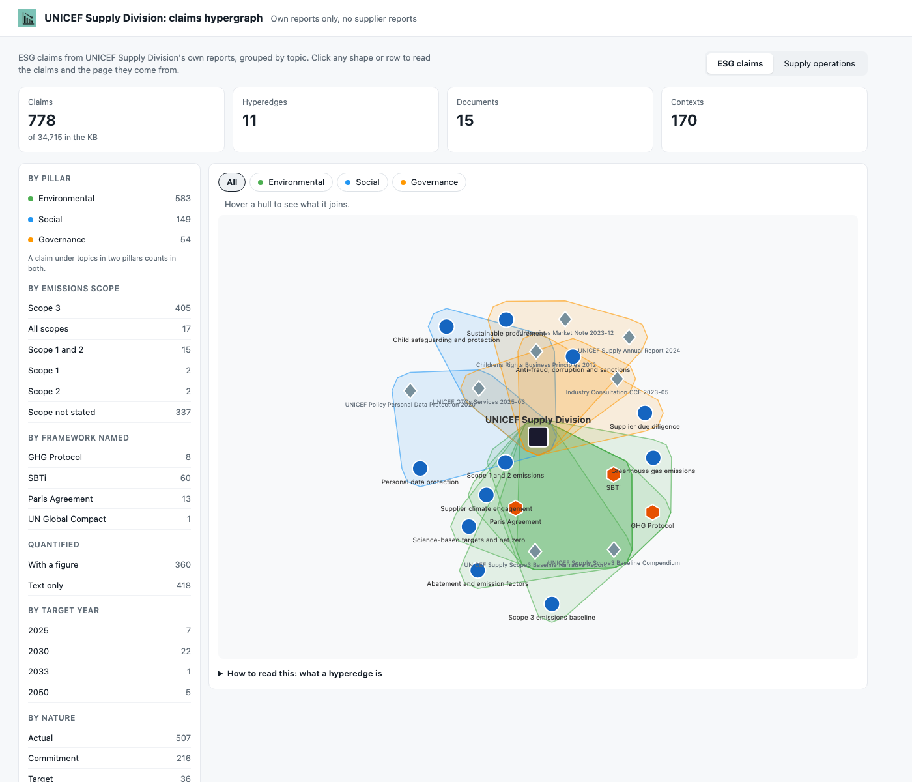

# UNICEF Supply Division prototype (GoCarbonTracker)

A static React and Vite app that shows what UNICEF Supply Division and its vaccine suppliers say in their own reports about climate and ESG. Every claim links to the PDF and page it came from. Figures are prototype data and have not been adjudicated.

Live: [unicef-supply-prototype.vercel.app](https://unicef-supply-prototype.vercel.app)



It was exported from `apps/public-sector` in [GoCarbonTracker/go-carbon-insights](https://github.com/GoCarbonTracker/go-carbon-insights) at `50cc9caf6`.

## UNICEF Supply Division's ESG status

This is what the Supply Division's own reports say, as saved in the prototype. Each point links to the excerpt it comes from.

- **One emissions baseline, for 2019 and for Scope 3 only.** The Supply Division's supply-chain emissions were estimated at 3,869 ktCO₂e against US$3.8 billion of 2019 spend ([excerpt](public/portfolio-evidence/d9c7221cd65b95cd.txt), [category table](public/portfolio-evidence/baseline-p012.txt)). Vaccines account for about 71% of that and nutrition for about 11%.
- **Estimated with the GHG Protocol, mostly from spend.** The baseline was calculated in line with the GHG Protocol, mostly with public secondary emission factors. Vaccines, syringes, RUTF, international freight, bednets, cold chain equipment and gloves used spend, activity or supplier-specific methods. Everything else used a simple spend-based approach ([excerpt](public/portfolio-evidence/d9c7221cd65b95cd.txt)).
- **No Supply Division Scope 1 or Scope 2 figure.** The baseline excludes both. The only operational figure in it is a UNICEF-wide 0.03 MtCO₂e for Scope 1 and 2 combined, with no division share ([excerpt](public/portfolio-evidence/baseline-p004.txt)). The saved evidence contains no later annual Supply Division emissions.
- **No published UNICEF science-based target yet.** The baseline report advises UNICEF to ask its largest suppliers for targets under the Science Based Targets initiative (SBTi) "even before it has itself aligned with the Science-based Targets Initiative" ([excerpt](public/portfolio-evidence/d26f3b5a500760ef.txt)). The 2025 annual report says UNICEF "initiated a project to align decarbonization targets" with SBTi ([excerpt](public/portfolio-evidence/2f4b39cdfe3aaf48.txt)).
- **Supplier engagement is the stated lever.** The baseline names 18 suppliers that drive the next 25 to 40% of Scope 3 emissions and do not yet have SBTs as the group to engage more deeply ([excerpt](public/portfolio-evidence/6b1fd37e7dd9e0e4.txt)). The 2025 annual report describes industry consultations and supplier sustainability surveys.

## How this tool supports it

The Supply Division's climate picture is spread across a baseline study, yearly annual reports, procurement annexes and the sustainability reports of each supplier. This prototype puts them side by side:

- Spend and climate statements sit on one row per supplier. That shows which large vaccine suppliers already report emissions and SBTi targets, which is the group the baseline says to engage, and which say nothing in their saved reports.
- Every figure opens the passage and page it came from, so a reader can check a claim instead of trusting the summary.
- Gaps are shown as gaps. A missing year or scope reads "not in the source", never zero.
- Claims are grouped in a hypergraph that keeps each statement together with its company, topic, year and source. [QUESTIONS.md](QUESTIONS.md) explains why that matters here.

It is a reading tool for prototype data. It does not compute emissions or score suppliers.

## Research questions

The pages are built around three questions that apply to any large buyer working on its supply-chain emissions. The answers below are for UNICEF Supply Division. [QUESTIONS.md](QUESTIONS.md) gives the full figures and names the hypergraph structure behind each answer.

### 1. Which purchase categories drive a buyer's supply-chain emissions, and do they follow spend?

For UNICEF Supply Division, purchased goods and services (GHG Protocol category 3.1) make up 3,555 of the 3,869 ktCO₂e in the 2019 baseline, and vaccines alone account for about 71%. Emissions do not follow spend. Cash and voucher assistance took US$214 million and produced 69 ktCO₂e, while bednets and insecticides took US$94 million and produced 173 ktCO₂e. A buyer that ranks categories by spend would set different priorities from one that ranks them by emissions. See `/portfolio`.

### 2. Do the suppliers that receive the most spend report on their own climate performance?

Mostly, but not all of them. Pfizer and GSK received the most UNICEF vaccine spend in 2025, and four of the five largest suppliers mention SBTi and report both measured emissions and forward targets. Biological E, the third largest, reports on emissions and energy but does not mention SBTi, and its reporting boundary is unresolved. Bio Farma and Bilthoven Biologicals together received over US$116 million in 2025, and their saved reports say nothing on the four climate topics shown. Spend concentration and climate disclosure do not line up, which is why the baseline's engagement advice needs supplier-level evidence. See `/suppliers`.

### 3. What does the buyer report about its own operational emissions, and at what boundary?

UNICEF Supply Division reports no Scope 1 or Scope 2 figure of its own. Its baseline covers Scope 3 only. The one operational figure, 0.03 MtCO₂e for 2019, is for UNICEF as a whole, with Scope 1 and 2 combined and no division share, so it cannot stand in for the division. Before using any operational figure, check which entity and which scopes it covers. The same boundary check applies to suppliers: `/suppliers` flags Biological E and GC Pharma for it. See `/portfolio`.

## Pages

| Route | What it shows |
|---|---|
| `/` | Landing page with links to the two parts below |
| `/suppliers` | Vaccine suppliers: UNICEF spend for 2019, 2024 and 2025 next to what their reports say on SBTi, operations, value chain and energy |
| `/map` | Supply chain map of suppliers, products and countries |
| `/climate` | Climate hypergraph: which of 22 climate concepts each supplier discusses |
| `/segments` | Supplier ESG claims grouped by segment |
| `/hypergraph` | Claims hypergraph of UNICEF Supply Division's own reports, ESG and supply operations kept apart |
| `/portfolio` | Division portfolio: 2019 emissions baseline, annual procurement, supplier reach |

Built with React 18, React Router 6, d3 7, Vite 7 and Vitest.

## Getting the code

The repository is private. Ask for access, then:

```sh
git clone https://github.com/varunmoka7/unicef-supply-prototype.git
cd unicef-supply-prototype
```

## Prerequisites

- [Node.js](https://nodejs.org/) 20.19 or later in the 20.x line, or 22.12 or later. Vite 7 refuses to start on older versions. Check with `node --version`.
- npm, which comes with Node.

## Run locally

```sh
npm install
npm run dev
```

The dev server prints its URL, normally `http://localhost:3100`. If port 3100 is taken, Vite picks the next free port. Open `/suppliers` to check it works: you should see the supplier table above.

## Test and build

```sh
npm test         # vitest, the page tests
npm run build    # typecheck, then build to dist/
```

`scripts/test_builders.py` tests the Python data builders. It only runs inside go-carbon-insights, because the builders read files at import time that are not in this repo.

## Data

The app reads prebuilt JSON from `buyers/unicef/`:

| File | Built by | Contents |
|---|---|---|
| `buyer.json` | no builder writes it | supplier list, climate concepts, disclaimers |
| `data/suppliers.json` | `scripts/build_suppliers.py` | supplier profiles with spend and own-report claims |
| `data/spend.json` | `scripts/build_spend.py` | Annex 2 spend records by year |
| `data/climate.json` | `scripts/build_climate.py` | supplier by climate concept cells, joined through hyperedges |
| `data/org_hypergraph.json` | `scripts/build_org_hypergraph.py` | Supply Division claims hypergraph |
| `data/map.json` | `scripts/build_map.py` | supply chain map |

`public/portfolio-evidence/` holds the source excerpts that `/portfolio` links to.

This repo ships prebuilt data only. The knowledge bases, source PDFs and extraction pipeline stay in GoCarbonTracker, so a clone can run and browse the app but cannot rebuild the data. The `scripts/` builders run inside go-carbon-insights with `services/hypergraph-rag/.venv/bin/python3`; set `PSP_KB_ROOT` when working from a worktree.

## Deploy

Vercel builds the site with `npm run build` and serves `dist/` as a single-page app (`vercel.json`). A push to `main` deploys to production, and every pull request gets a preview URL.

## References

- [GoCarbonTracker](https://gocarbontracker.net), the project this prototype comes from.
- [GoCarbonTracker/go-carbon-insights](https://github.com/GoCarbonTracker/go-carbon-insights), the main repository with the knowledge bases and the extraction pipeline. Private.

## License

Private prototype. Not licensed for reuse.
